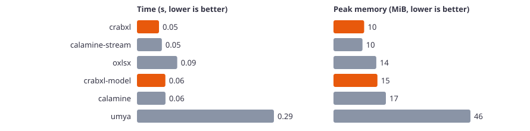
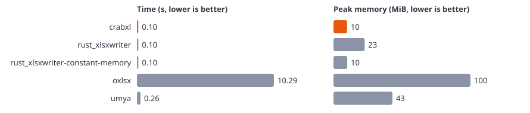
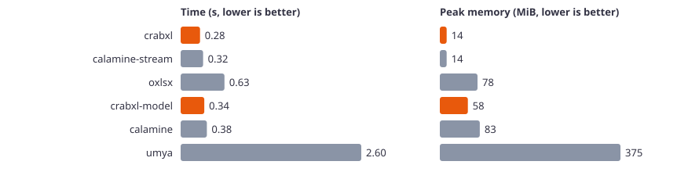
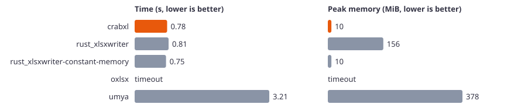
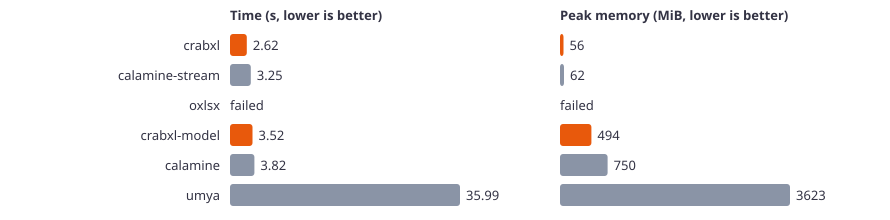
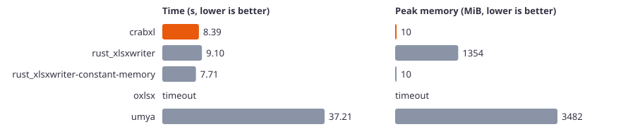

# Rust benchmark results

Machine: Windows 11, AMD64 Family 25 Model 80 Stepping 0, AuthenticAMD, 12 logical CPUs. Median of 3 runs. Time is the wall time of the whole process. Memory is the peak resident memory of the process.

## Read, small (10,000 rows × 10 columns)

| Library | Time (s) | Peak memory (MiB) |
|---|---:|---:|
| crabxl | 0.047 | 10.2 |
| calamine-stream | 0.053 | 9.6 |
| oxlsx | 0.086 | 14.2 |
| crabxl-model | 0.061 | 14.6 |
| calamine | 0.061 | 17.4 |
| umya | 0.292 | 45.5 |

## Write, small (10,000 rows × 10 columns)

| Library | Time (s) | Peak memory (MiB) |
|---|---:|---:|
| crabxl | 0.099 | 10.0 |
| rust_xlsxwriter | 0.104 | 22.8 |
| rust_xlsxwriter-constant-memory | 0.102 | 10.1 |
| oxlsx | 10.294 | 100.3 |
| umya | 0.263 | 43.2 |

## Edit, small (10,000 rows × 10 columns)

| Library | Time (s) | Peak memory (MiB) |
|---|---:|---:|
| crabxl | 0.288 | 15.9 |
| oxlsx | 0.608 | 86.9 |
| umya | 0.393 | 48.9 |

## Read, medium (100,000 rows × 10 columns)

| Library | Time (s) | Peak memory (MiB) |
|---|---:|---:|
| crabxl | 0.280 | 14.1 |
| calamine-stream | 0.324 | 14.2 |
| oxlsx | 0.632 | 78.1 |
| crabxl-model | 0.341 | 58.2 |
| calamine | 0.378 | 82.9 |
| umya | 2.602 | 374.5 |

## Write, medium (100,000 rows × 10 columns)

| Library | Time (s) | Peak memory (MiB) |
|---|---:|---:|
| crabxl | 0.776 | 10.0 |
| rust_xlsxwriter | 0.811 | 155.8 |
| rust_xlsxwriter-constant-memory | 0.749 | 10.1 |
| oxlsx | > 900 | – |
| umya | 3.215 | 377.9 |

## Edit, medium (100,000 rows × 10 columns)

| Library | Time (s) | Peak memory (MiB) |
|---|---:|---:|
| crabxl | 3.147 | 59.6 |
| oxlsx | 14.365 | 1249.7 |
| umya | 4.632 | 414.6 |

## Read, large (1,000,000 rows × 10 columns)

| Library | Time (s) | Peak memory (MiB) |
|---|---:|---:|
| crabxl | 2.625 | 55.5 |
| calamine-stream | 3.248 | 62.5 |
| oxlsx | failed: incomplete: handled 1,715,030 of 10,000,000 cells | – |
| crabxl-model | 3.525 | 493.9 |
| calamine | 3.820 | 750.4 |
| umya | 35.993 | 3622.6 |

## Write, large (1,000,000 rows × 10 columns)

| Library | Time (s) | Peak memory (MiB) |
|---|---:|---:|
| crabxl | 8.390 | 10.0 |
| rust_xlsxwriter | 9.099 | 1353.6 |
| rust_xlsxwriter-constant-memory | 7.715 | 10.1 |
| oxlsx | > 900 (estimated from the smaller size) | – |
| umya | 37.212 | 3481.8 |

## Edit, large (1,000,000 rows × 10 columns)

| Library | Time (s) | Peak memory (MiB) |
|---|---:|---:|
| crabxl | 32.121 | 497.0 |
| oxlsx | 197.271 | 9958.9 |
| umya | 49.832 | 3858.9 |
